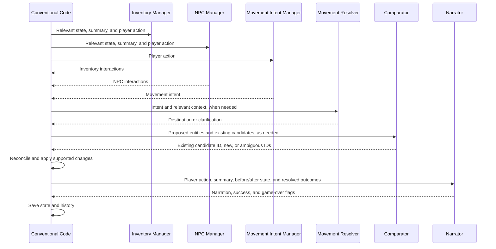

# Implementation

## Architecture and authoritative state

LLMs interpret natural language and narrate outcomes. Deterministic code owns
IDs, identity reconciliation, persistent effects, and database writes. Models
receive natural-language names and descriptions; identity resolution and tool
calls also receive canonical IDs. Changes are
built on a candidate state and committed only after required processing succeeds.

State contains:
- **Game:** player, current location, active/ended status, and end reason.
- **World:** locations, exits, items, objects, and NPCs with stable IDs.
- **History:** all literal exchanges in `history.recentEvents` (a legacy name,
  not a sliding window), a separately derived `summary`, its covered
  `summaryEventCount`, and the last actual movement IDs in `lastMovement`.

Existing object records remain readable/displayable, but current turn processing
does not create or update persistent objects. Supported effects are described
below; broader product goals are distinguished in [Product Spec](PRODUCT_SPEC.md).

## LLM components and contracts

### Freeform mode

Mode selection is saved immediately through `POST /game/mode`, independently
of successful story turns, and restored on reload. Changing mode increments the
game revision so an older in-flight turn cannot overwrite the selection.
New games reset to Managed.

The mode switch can select `freeform` for any turn. It makes one plain-text
`freeform_narrator` call with the full literal transcript as conversation messages
and the current action. No world state or summary is sent, and no manager,
comparator, or summarizer is called. The response is appended to the transcript;
tracked locations, items, NPCs, objects, exits, movement history, and game-over
status are left untouched. The sidebar still shows the last tracked state and
may be stale. Switching back does not reconstruct missed world changes.

### Tool using mode

`tool_using`, labeled **Tool using**, runs a game master conversation with native
Ollama/OpenRouter function tools. The prompt and tool schemas live in
`shared/llm/game_master.md` and `shared/llm/game_master.tools.json`.
The engine supplies the full literal history as conversation messages, player
action, current location, local available items (including those held by present
NPCs), present active NPCs, carried inventory, and known location IDs. A current
prepared historical summary is also supplied when available.

The game master interprets intent and contextual plausibility, choosing zero or
more tools before returning plain-text story. It must not narrate unperformed
state changes. Tools run sequentially, including calls returned in one batch,
and each result returns canonical entities plus the updated scene. Dependent
calls must wait for newly created IDs:

Each round offers only currently applicable tools; ID parameters enumerate
eligible draft-state IDs. For example, pickup is not offered until a local item
exists, and existing-location movement is not offered when no other location
exists. These are state constraints, not natural-language intent filters.
Tool selection uses temperature zero. After each batch an authoritative scene
checkpoint reminds the model that rejected operations had no effects.
Ollama tool requests reserve a 16,384-token context and up to 2,048 generated
tokens per response; its smaller default context can truncate tool instructions.

| Tool | Effect |
|---|---|
| `move_to_location` | Move the player to an existing location. |
| `move_to_new_location` | Resolve/create a destination, then move the player. |
| `create_item` | Resolve/create an item in an existing location, not inventory. |
| `pick_up_item` | Put an accessible available item into inventory. |
| `drop_item` | Put a carried item in the current location. |
| `destroy_item` | Remove an accessible item, including complete consumption. |
| `create_npc` | Resolve/create an NPC in an existing location. |
| `destroy_npc` | Mark a present active NPC dead; leave its items at that location. |
| `move_npc` | Move a present active NPC to an existing location. |

Creation uses the shared candidate-list comparator before adding a record.
Existing matches retain their canonical data and holder/location; they are
neither teleported nor revived. Plausibility is the game master's responsibility,
not a deterministic keyword filter. Tools validate schemas, IDs, accessibility,
and blocked routes. Successful movement connects locations in both directions;
player movement records `lastMovement` and visits the destination.

Tools operate on a draft. Invalid arguments, ambiguous identity, and state
constraint violations roll back just that tool and return explicit errors to
the game master for correction or clarification. Provider failures, empty or
JSON-only final text, reused call IDs, or exceeding 12 LLM rounds / 32 tool calls reject the
entire turn. Nothing is persisted until normal game/revision checks and atomic
commit succeed. NPC death preserves references; player death/termination is
not yet supported by this tool set.

After final story text, the engine appends the completed exchange and commits
the turn without waiting for summarization. Once the frontend displays the saved
story, it triggers a separate `/game/prepare` request, as for Managed mode.
Preparation errors appear in debug progress without discarding the saved turn;
revision checks prevent late summaries from overwriting newer turns. Full
history remains available if the next action begins before preparation finishes.

Debug progress records each game-master request, each tool invocation, and any
nested comparator call in execution order, with operation IDs linking updates
and parent IDs linking nested calls. Server logs include requests, responses,
tool results, and failures. Existing modes remain independent.
Native-tool support alone does not guarantee reliable tool planning. Local live
checks verified compound movement/creation/pickup with `gemma4:latest`;
`llama3.2:latest` handled a simple pickup but was unreliable on compound actions.
The implementation does not silently switch the configured provider or model.

System prompts, user-message templates, and optional response schemas live in
`shared/llm/`, named after each call. A call's `<name>.input.md` template uses
`{{input}}` where the serialized call input should go.
Definitions are read when a call instance is created, so edits to prompts,
templates, and schemas apply to subsequent instances without a backend restart.
[Shared definitions](../shared/README.md) explains loading and deployment.

### Inventory manager

Receives `current_action`, `historical_summary`, the current location, carried
items, local items/objects, and present NPCs. Returns only `items`, each with
`name`, `description`, and `interaction` (`take`, `drop`, `give`, `consume`, or
`break`). Only `give` additionally requires `recipient`, a present NPC's name.
The response schema uses separate give/non-give branches so constrained output
requires a recipient for give and disallows it for other interactions.
All disposal operations match available carried items only; missing targets are
ignored with reasons, never created. `give` transfers ownership to an existing
active NPC in the starting location; an absent or unmatched recipient leaves
the item carried. NPC-held items are already supported by the holder model.
`consume` and `break` delete the matched item record, without spawning remains.

Code recognizes simple explicit named-item commands and corrects reversed labels
when the proposed item matches the requested target. Normalized exact names,
ignoring a leading article or "my", match without an LLM call. Different names
use the shared identity comparator before accepting or rejecting the proposal;
for example, "mug" can match "mug of beer" without allowing unrelated items.
Unrelated proposals for those commands are ignored with reasons.
Compound, conditional, negated, pronoun-based, and unsupported wording is left
to manager interpretation. Original output is retained; corrections appear in
effective output and progress.

Carried items persist across location changes and omission from manager output.
Disposal intent is interpreted by the inventory manager, not keyword allowlists
in the engine. State eligibility and identity checks still apply. A drop combined
with travel leaves the item in the starting location.
Simple eat/drink/consume and break/smash/destroy commands also
correct reversed labels for matching targets. Partial consumption, suitability,
negation, and complex requests remain the inventory manager's responsibility.

Inventory proposals are identity-checked against known NPCs and the NPC manager's
current-turn proposals, using the shared text matching/comparator path. Matches
are logged and reported as ignored, not created as items or retained as resolved
inventory interactions. NPCs, including animals and mounts, are never inventory.

### Movement intent and resolution

`map_manager` receives only `current_action`, without world state or history, to
avoid biasing intent toward familiar places. It returns `movement` and `target`:
false requires null; true requires `text` and a `kind` from `named`, `back`,
`relative`, `directional`, `exploratory`, or `reference`.
The schema constrains these combinations. If a provider nevertheless returns
false with a non-null target, validation discards the unused target with a
warning, preserving the raw response in diagnostics. Missing fields, non-boolean
movement flags, and malformed targets for true still fail validation.

- **Named:** use the destination text and a neutral description for identity
  matching; create a new place if no existing identity matches.
- **Back:** use `history.lastMovement` directly. Legacy saves without it ask for
  a destination until an actual movement is recorded.
- **Other kinds:** call `movement_resolver` with intent, current room, available
  and blocked exits, known locations, and last movement. Relative/reference
  requests additionally receive the last three completed exchanges and nearby
  NPCs. The response contains `destination` and `clarification`: either an
  objective destination or a question/explanation, not an invented substitute
  for an ambiguous reference.
  A response with both fields null is recovered with a logged warning and
  "Where would you like to go?" clarification. A response containing both a
  destination and a valid clarification is recovered with a logged warning:
  clarification takes precedence and the destination is discarded. No movement
  is applied; narration and other valid turn effects can continue.
  Other malformed responses still fail.

An explicit destination takes precedence over a direction. Exploratory travel
can name the area being explored without specifying a destination to reach.
Missing exits can represent unexplored routes, not necessarily blocked ones.
Intent and contextual resolution use temperature zero.

Raw intent remains in `turn.manager_results.map`; effective map results contain
engine-generated location interactions. `movement_resolution` exposes the
destination/clarification, and `movement_outcome` records actual `moved`,
`from_location`, and `to_location` values.

### NPC manager

Receives the action, summary, current location, and NPCs there. Returns only
`npcs`, each with `name`, `description`, and an interaction classification.
Animals and mounts are NPCs. Reports identify entities; they do not update
existing NPC location/status or model motivations.

### Narrator

The managed narrator privately considers plausible future storylines rooted in
the current action and existing threads, then seeds concrete, motivating leads
in the narration. Engaging with a lead should produce discoveries and progress,
not repeated portents. These possibilities adapt to player choices; they are
not stored plans and do not authorize unsupported persistent state changes.
Inspection, questions, and successful opening actions should produce specific
observable answers in the same response, not defer the payoff to more portents.

Receives the action and summary once each, history-free `resolved_context`,
resolved/ignored interactions, and movement outcome/resolution. The context
contains only the resulting current location, its exits, carried items, and local
NPCs, items, and known objects. No starting-state snapshot or global lists of known
items, locations, or NPCs are sent. Returns only:

```json
{
  "narration": "Player-facing response",
  "action_succeeded": true,
  "game_over": false
}
```

It describes outcomes without replaying history, overriding effects, or exposing
implementation details. It develops story threads and fair puzzles within those
boundaries. `action_succeeded` describes overall intent and does not undo partial
effects. `game_over` ends the game for character death.

### Comparator and identity

Receives `entity_type`, the complete eligible `candidates` list, `proposed_entity`,
and context (current location, player ID, and up to six recent exchanges).
Candidates include IDs, names/descriptions, and available aliases and holder/location
information. Returns one of:
- `{"outcome":"existing","entity_id":"<candidate ID>"}`
- `{"outcome":"new"}`
- `{"outcome":"ambiguous","candidate_ids":["<ID>","<ID>"]}`

Code validates the response shape and verifies every returned ID belongs to the
eligible list. Ambiguity requires at least two distinct IDs. `new` means no
candidate matches, not approval to create. The comparator does not perform actions.
Untracked current-turn proposals and synthetic command targets receive temporary
candidate IDs for this call only; these IDs are not persisted.
The provider schema requires all three fields (`outcome`, `entity_id`,
`candidate_ids`) without conditional schema branches. Unused fields must be
`null` and `[]`; validation normalizes valid responses to the compact forms
above. Missing existing IDs, conflicting fields, and invalid ambiguity lists
still fail rather than defaulting to a match or creation.
Identity comparisons use temperature zero. The prompt distinguishes aliases and
compatible shorter names from adjacent places, conflicting materials, and
owner/possession relationships; shared words or entity type alone are not matches.

Before calling it, code normalizes case, punctuation, spacing, and Unicode:
- A unique normalized canonical name or stored alias resolves directly.
  "Tavern" does not match "Town Square Outside the Tavern".
- Multiple identical name/description matches are ambiguous.
- Names or aliases shared by eligible candidates require semantic comparison,
  not an arbitrary selection. Candidate aliases are included in comparator input.
- Otherwise all eligible candidates are resolved in one LLM call. An existing
  match retains its canonical record and ID; ambiguity rejects the turn.
- No matches allow creation only for supported interactions. Empty candidate
  lists skip the call.

Canonical results appear in `turn.reconciled_entities`.
An unambiguous comparator match records a different proposed name as an alias
on the canonical entity, without renaming it or duplicating normalized aliases.
Synthetic command targets are not canonical entities and do not learn aliases.
Aliases are saved atomically with the turn; failed turns do not persist them.
Ambiguity marks the candidate-list comparator operation failed: Request details
identify the proposed entity and eligible candidates, and Response lists every
conflicting match under `matched_entities`. Deterministic ambiguity is logged
without an LLM call.

## Supported state transitions

- **Take:** compare available items carried by the player, in the current room,
  or held by an active NPC there. Move a resolved local item into inventory, or
  create a plausible action-established item there.
- **Drop:** compare available carried items and move a match to the starting
  room. A missing match is a reported no-op, not item creation.
- **Movement:** resolve the destination, excluding departure from candidate
  comparisons. A normalized destination name equal to the current room is a
  no-op. Respect explicitly blocked connections; otherwise create reciprocal
  traversable exits when needed, mark the destination visited, update current
  location, and record `lastMovement`. Code generates `leave`/`enter` entries.
- **NPCs:** reconcile at the resulting location; existing NPCs keep location
  and status.

Inventory runs before movement so drops stay in the departure room. Unresolved
movement and ignored inventory proposals appear in `ignored_interactions` with
reasons for narration; other valid effects may continue. Ambiguous identity or
invalid required responses fail the turn without saving.

Persistent object changes and NPC simulation are unsupported.
`notable_elements` and `effective_manager_results` contain
retained interpretations, never narrator-generated entity lists.

## Turn sequence



1. Validate action, authentication, game ID, request ID, and active status.
2. Obtain a current historical summary, regenerating it if missing/stale.
3. Run inventory, movement-intent, and NPC calls in parallel with scoped inputs.
4. Apply inventory, movement resolution, and NPC reconciliation to a candidate.
5. Narrate using starting/resulting context and retained outcomes.
6. Append the literal action/narration pair and apply any character death.
7. Commit atomically with a version check and persist the idempotent response.
8. Return immediately; the browser requests preparation of next-turn history.

## Full-history summarization

The Summarizer receives the full saved literal history, not a sliding window
or previous summary. It produces only `summary`, a non-empty string of at most
24000 characters. Length grows with the adventure, preserving character names
and aliases, relationships, meaningful dialogue, plot causes and consequences,
active goals, clues, puzzle details, and resolved and unresolved threads.
Repetitive scenery is compressed before meaningful facts; short and moderate
histories should retain plot and identity details rather than favoring recency.
Failed in-world attempts are
completed events; processing failures are not.

`POST /game/prepare` takes `game_id` and runs in a separate request, compatible
with CGI. Preparation does not disable the next action or delay returning a saved
turn. It stores the summary separately only if game ID and revision still match;
late results cannot overwrite a newer turn, restart, or stop. Successful responses
include `summary` and `summaryEventCount`, including cached results.

A summary is current when its covered count equals literal history length.
Legacy summaries without a count are regenerated. Before the first action,
the summary is empty and starting state supplies context. Inventory, NPC, and
Narrator receive the overview as historical background; Comparator receives
up to six recent exchanges as identity context. The pending action is never
part of its own historical summary.

Preparation failures appear in debug progress without rolling back the turn.
The next action regenerates missing context before interpretation, potentially
delaying that response. Late preparation UI updates are ignored after another
action or restart. Recent-event emphasis is a prompt requirement, not a
deterministically checked semantic guarantee.

## Progress and validation

Schemas and call-specific validators check required fields, types, and allowed
values before reconciliation. Required provider/validation failures leave saved
state unchanged. API response/stream formats and diagnostic log details are in
the [backend guide](../backend/README.md#streaming).

Progress retains one entry per operation, updating waiting, started, received,
and saving statuses in place. Repeated calls retain separate entries. Pending
operations show spinners; stream failures mark them interrupted. Request,
response, and entity details are collapsed by default.
Movement resolution has its own entry every turn, initially waiting for intent
and inventory reconciliation. Contextual calls show request/response and provider
details; no-travel, named, and return paths show deterministic inputs/results
and a skipped-call reason without implying an LLM was invoked.

Comparator progress exposes one LLM candidate-list resolution per proposal and
results, while deterministic matches, deterministic ambiguities, and
empty-candidate skips remain logged but hidden from the UI. The Narrator shows
waiting before reconciliation and skipped with a reason if it cannot proceed.
Intermediate reports are debug information, not committed world state.

## Validation coverage

Focused tests cover identity matching, scoped context, schema validation,
supported transitions, literal history retention, summary preparation/version
safety, atomic failures, and API request deduplication. Live movement checks are
opt-in and use local Ollama. See [test commands](../backend/README.md#testing).
