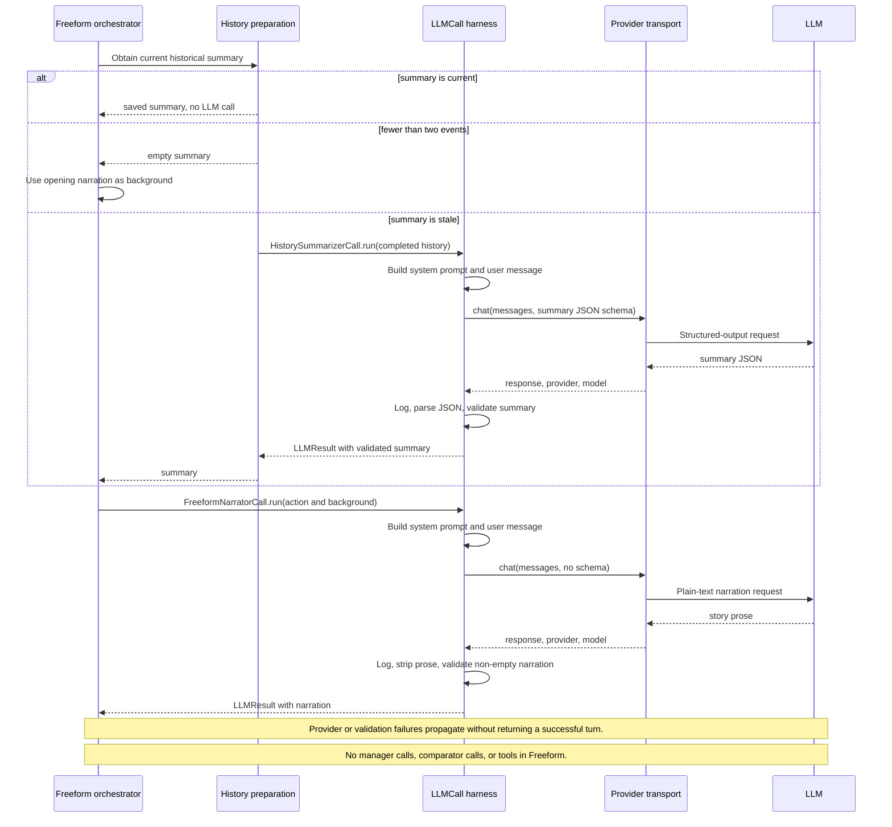
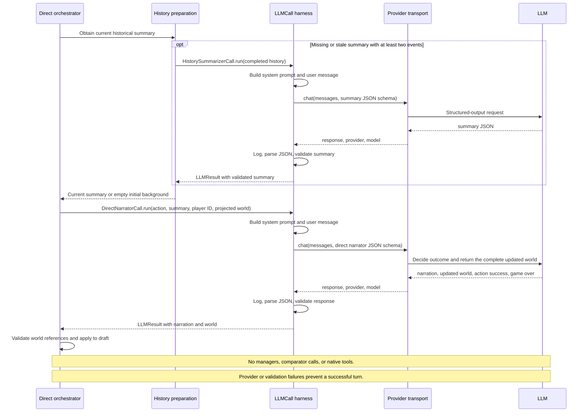
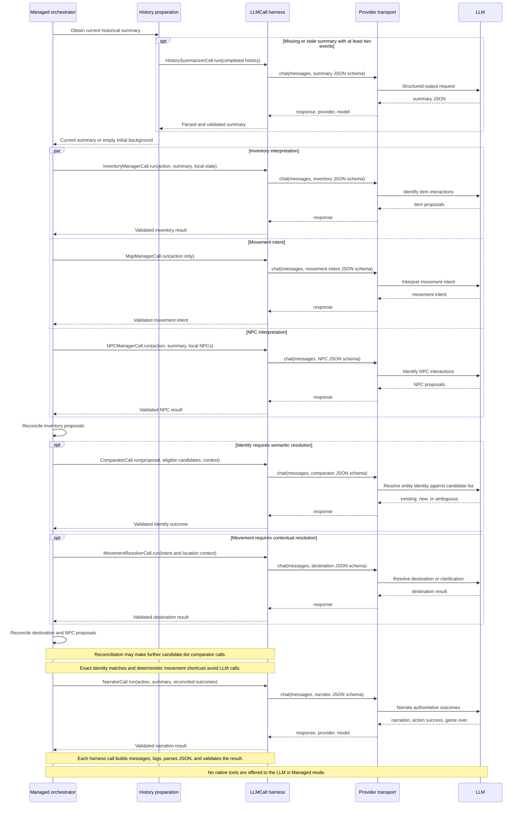
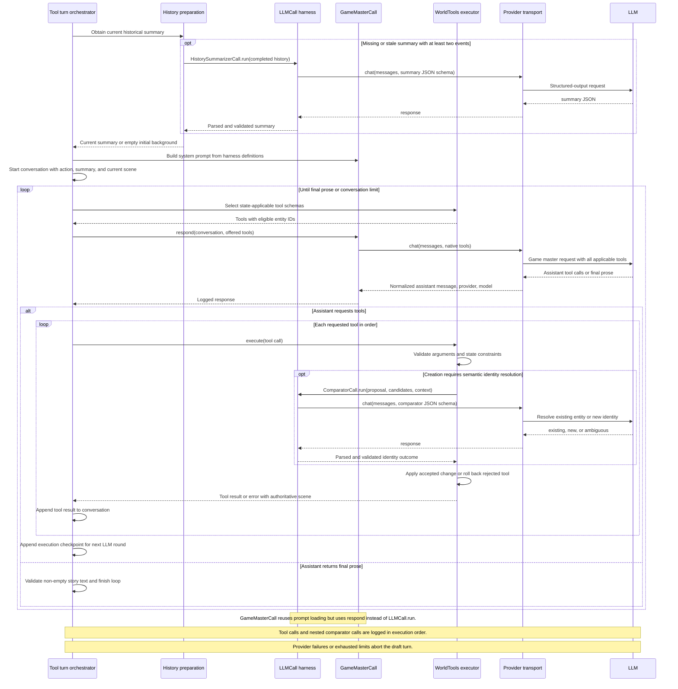

### Freeform Mode

Freeform treats the LLM as a storyteller rather than a world-state manager.
The narrator receives the player's action and a continuity summary, or the
opening narration on the first turn, and returns plain prose. It receives no
tracked world state, JSON output schema, or tools. Apart from preparing missing
history, each turn needs just one LLM call.

Only the action and narration are added to history. Tracked locations,
inventory, NPCs, and game-over status remain unchanged, so the sidebar can
become stale as the story develops. This makes Freeform the least constrained
mode, but switching to a stateful mode does not reconstruct those untracked
changes.

### Direct Mode

Direct extends Freeform's storytelling with explicit world-state updates.
One narrator LLM receives the action, continuity summary, player ID, and a
projection of the tracked state, then returns structured JSON containing
narration, the complete updated world, action success, and game-over status.

The harness validates the response, and conventional code checks world
references before applying it to a draft. There are no specialist managers,
semantic comparator calls, or incremental tool operations. This keeps
orchestration simple but asks one model to maintain entity identity and world
consistency in a single response. Managed refines this approach by separating
interpretation, reconciliation, and narration.

### Managed Mode

Managed refines Direct's single-call world updates by splitting interpretation
across specialist LLM calls. Inventory, movement
intent, and NPC managers run in parallel, then conventional code reconciles
their proposals into a draft world. When identity is uncertain, the comparator
receives an eligible candidate list and resolves it to an existing entity,
a new identity, or an ambiguity. A separate movement resolver handles
destinations that cannot be determined through deterministic shortcuts.

The narrator runs last and describes the reconciled outcomes rather than
choosing world changes itself as it does in Direct. Unlike Tool Using, the LLM does not choose which
functions to invoke: the engine owns the workflow and interprets structured
JSON responses. This provides explicit state constraints and specialist
reasoning, at the cost of more LLM calls per turn.

### Tool Using Mode

Tool Using lets a game-master LLM choose the sequence of world changes. It
receives the action, continuity summary, and current scene alongside native
tool schemas for moving the player and creating, moving, acquiring, dropping,
or destroying entities. Each request offers all currently applicable tools
together, with eligible IDs constrained by the draft state.

Conventional tool functions validate and apply changes, invoking the semantic
comparator when creation needs identity resolution. Tool results and the
updated scene go back into the conversation, allowing further LLM rounds
before final plain-text narration. Unlike Managed's fixed pipeline or Direct's
whole-world replacement, the model controls incremental operations. Rejected
tools return errors without changing the draft, while provider failures or
conversation-limit failures abort the turn.

After a successful turn in any mode, separate history preparation can run
`HistorySummarizerCall` through the same harness and provider transport. It does
not delay returning the story. The next turn reuses the prepared summary when
current, or regenerates it before proceeding.